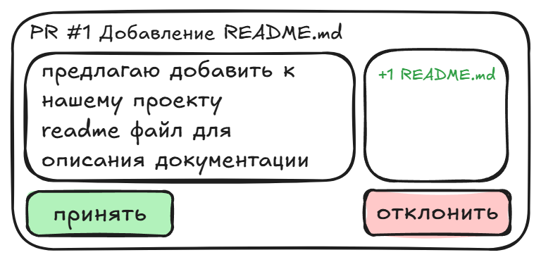
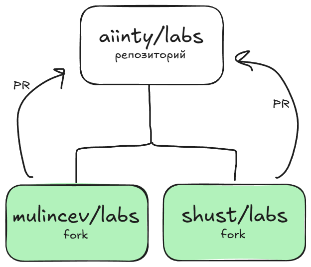
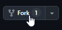
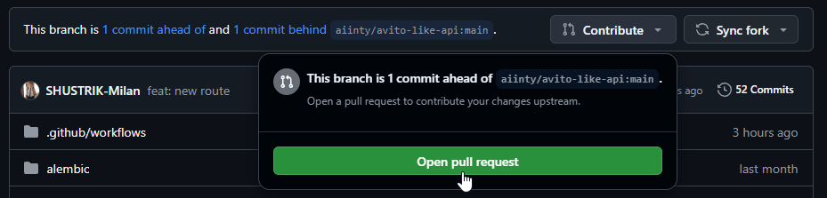
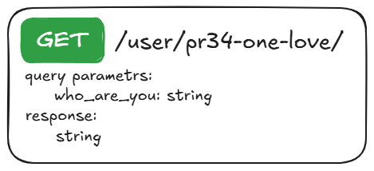
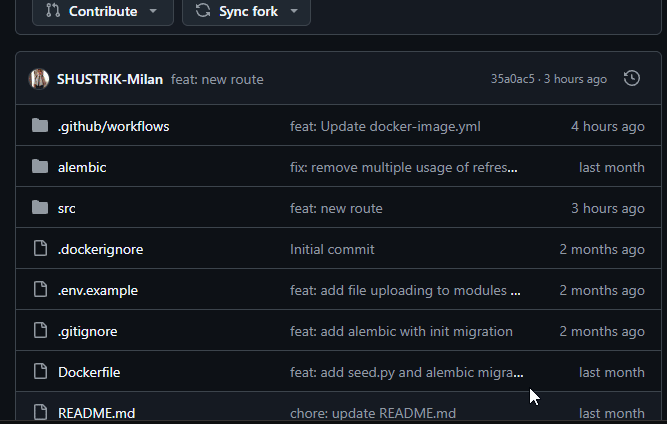
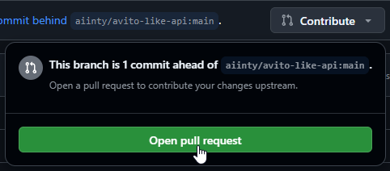
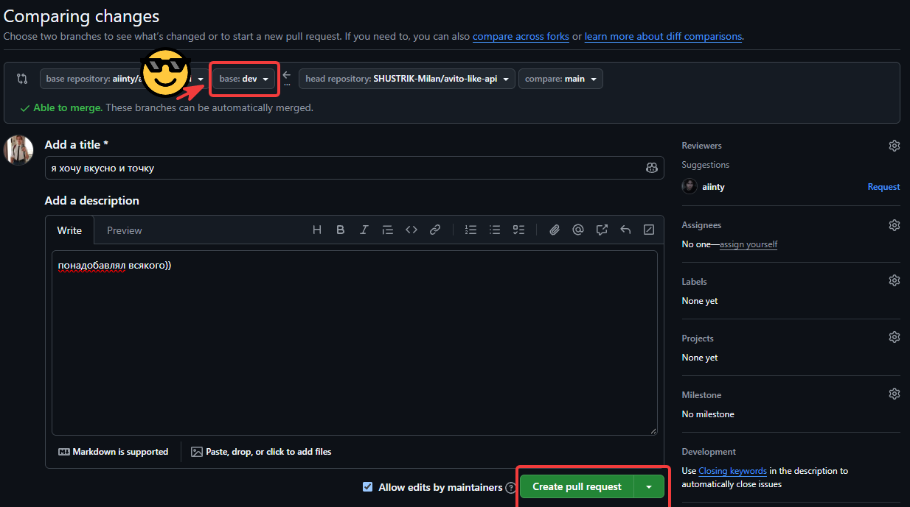

# Работа с Pull Request

## Теория

### Pull Request
> [!Note]
> **Pull Request (PR)** – это предложение внести изменения из вашей ветки кода в общий проект или основную ветку репозитория. В нашем случае, репозиторий будет располагаться на сервисе [Github](https://github.com). PR удобно использовать при наличии командной работы над одним проектом.

**PR** выглядит как заметка к предлагаемым изменениям, например:



У **PR** есть:
- **Название**. В нашем случае: Добавление README.md
- **Описание**.
- **Список измененных файлов.** В нашем случае: +1 README.md файл.

У администратора репозитория или любого другого человека с доступом есть возможность применить или отклонить **PR**. При принятии, код, написанный в **PR**, станет частью финального продукта.

### Fork
**Pull Request'ы** можно делать как в том случае, когда вы являетесь участником репозитория и имеете к нему доступ, так и в том, когда этот доступ у вас отсутствует. В таком случае Вы так же можете предложить проекту свои изменения и помочь ему стать лучше. Для этого используются **Fork'и**.

> [!Note]
> **Форк** (от англ. _fork_ — вилка, ответвление) — это копирование исходного кода программного обеспечения или данных с целью дальнейшей независимой разработки нового проекта на базе старого. Личная копия чужого репозитория в вашем аккаунте. Она нужна, чтобы безопасно вносить изменения и отправлять их обратно автору через запрос на слияние (_pull request_).



## Практика
Давайте попробуем применить **PR** на практике и провзаимодействовать с уже знакомым Вам репозиторием:

<h3><code>https://github.com/aiinty/avito-like-api/</code></h3>

> Этот проект демонстрирует, как мобильное приложение может взаимодействовать с бэкендом на базе REST API, включая аутентификацию, профили пользователей, объявления на маркетплейсе, обмен сообщениями и загрузку изображений.

Станем частью этого проекта и привнесем свои изменения!

### Создание Fork'а
Для начала нам требуется создать Fork. Для этого перейдите по ссылке на Github-репозиторий. Справа сверху вы увидите кнопку **Fork**. 

> [!CAUTION]
> Важно, чтобы вы были авторизованы на [Github](https://github.com). Если это не так, то просто перейдите по этой ссылке: [github.com/login](https://github.com/login)

Теперь, в открывшейся вкладке Вы можете настроить репозиторий, как это обычно происходит, когда вы создаете новый. Можете поменять название, либо оставить прежнее.



После создания вас встретит главная страница Вашего репозитория. Заметным отличием является плашка над файлами репозитория, которая отображает статус Fork'а: то насколько он отстает или преуспевает над родительским репозиторием и возможные действия:
- Отметить свои изменения репозитория и прикрепить их в новый **PR**
- Синхронизироваться с родительским репозиторием, подтянув его свежую версию
Конкретно в нашем случае, приоритетнее будет первая функция. Ею мы и будем пользоваться.

### Вносим коррективы
Теперь Вы можете внести некоторые коррективы в код проекта. Для небольшого примера мы добавим новый эндпоинт следующего формата:



Для этого перейдем по директории `src/modules/users/router.py` и в конце добавим следующий блок кода:

```python
@users_router.get("/pr34-one-love/")
async def pr_34_one_love(
    who_are_you: str
) -> str:
    return f"ЙОУ! {who_are_you} из ПР34 ты крут!"
```

Сделать это можно двумя способами.
#### Работа с браузерной версией GitHub
Для этого способа нам не понадобится никаких предварительных настроек. Лишь перейти по нужной директории прямо на сайте и войти в режим редактирования:


#### Работа с локальным репозиторием
Там реально сложно, но если сильно хотите позовите меня...

### Создаем PR
Теперь, когда мы сделали коммит с изменениями, то есть сохранили внесенные данные. Все что нам остается это обратиться к панели статуса нашего Fork'а и вызвать следующее меню:



Там вы описываете ваши изменения, почему они должны быть приняты и т.д.



Обязательно укажите ветку `base: dev` и жмите заветную кнопку **Create Pull Request**. Как только вы создадите **PR** мы обязательно рассмотрим него и перезвоним Вам...

Протестировать свои изменения Вы сможете на: [95.31.156.238:8000/docs](http://95.31.156.238:8000/docs)

## Небольшой лайфхак
Вероятнее всего, вы не имели дела с Python, а если и имели, то вы не писали `avito-like-api`, в таком случае, для оперативного решения данной сложившейся ситуации, можем предложить вам использовать следующий промпт для добавления изменений, которые вы хотели бы видеть в сервисе:

```
Проанализируй код данного репозитория: github.com/aiinty/avito-like-api
Предложи мне наипростейший способ добавить новый функционал. Учти:
- ты должен работать только с тем стэком, что уже есть и не вносить в него коррективы;
- твой ответ должен содержать только четкие шаги к решению поставленной задачи, которые я должен выполнить;

Хочу добавить:
Роут для Users, который будет возвращать всех существующих пользователей
```

Можете попросить любое улучшение в рамках разумного. Удачи! 🎉